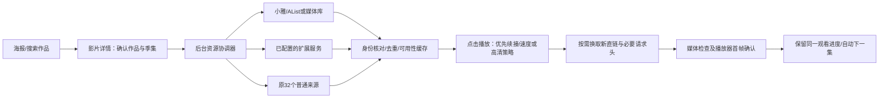

# TVBox PC 下一阶段：高清资源与网盘整合方案

设计日期：2026-11-07。状态：**设计稿，尚未接入或实测用户的小雅/G-Box/网盘**。本轮0.8.3先交付界面与图片链路修复，以下是后续0.9.x实施方案。

## 期望的使用方式

设置一次服务器地址和必要的账号/Token，完成连接检查后即可继续在豆瓣/Netflix/TMDB海报墙找片。所有影片仍先进入详情；进入详情时后台查询可用资源，点击播放才解析链接和真正开播。用户不必先打开资源站、搜索网盘、挑选文件或粘贴直链。

第一次连接引导只需：选择服务→填写地址和必要凭据→选择允许搜索的资料库/目录→验证一部电影和一集剧集→启用“参与自动选源”。无需账号的服务不要求账号。连接失效时保留配置，在设置中显示原因，避免反复弹窗打扰。

## 接入顺序与兼容范围

| 阶段 | 服务/协议 | 做法 | 通过标准 |
| --- | --- | --- | --- |
| A | 小雅/AList/OpenList一类文件服务 | 优先使用服务器已有搜索索引，搜索/列表/取文件信息分开；播放前换取直链 | 用户服务上的电影+第二季剧集实际出画面、拖动、续播；过期直链可重新获取 |
| B | Emby/Jellyfin（含G-Box若实际提供此接口） | 按媒体库/用户范围搜索，利用TMDB/IMDb及季集身份；优先DirectPlay，必要时明确显示服务器转码 | 正确电影/季/集/音轨/字幕；不混入无权限库；服务临时离线可退回其他已配置来源 |
| C | G-Box专用桥接 | 先确认准确产品、版本与公开接口；若提供AList或媒体库API，复用A/B；否则单独适配 | 不从产品名称猜测接口，不将G-BOX.AI等同名无关项目接入；用户实例实际验收后开启 |
| D | Nuvio使用的Stremio HTTP扩展 | 导入manifest并识别stream能力；按可靠TMDB/IMDb与季集查询，接收直链、字幕和请求头 | HTTP直链端到端播放；没有直链的结果明确分类，不冒充可播 |
| E | Nuvio原生JS提供方 | 与Stremio协议分开；选少量维护活跃的模块做兼容，优先已有HTTP服务，必要时移植解析逻辑 | 每个模块分别核对许可、运行依赖、语言与实际画面；不承诺全部插件一键兼容 |
| F | Cloudstream扩展 | 优先已有HTTP桥接/可移植接口；仅按需移植选定解析器 | Android插件不直接当作Windows插件运行，不引入整套Android模拟器或庞大JVM来换取“全部兼容” |

小雅官方项目列有AList与元数据/搜索等周边；具体服务是否启用搜索索引、哪些目录可见，需要通过用户实例能力探测确认，不能由安装名称推定。[小雅项目说明](https://github.com/xiaoyaDev/xiaoya-alist)、[AList文件API](https://alistgo.com/guide/api/fs.html)。

Emby官方提供REST API及用户/Token认证；G-Box若暴露兼容服务可复用适配器，私有API则不能假装已兼容。[Emby API](https://dev.emby.media/doc/restapi/index.html)。

Nuvio有插件管理和JS提供方，另有HTTP扩展生态，两类不能混用一个导入器。[NuvioTV插件管理源码](https://github.com/NuvioMedia/NuvioTV/blob/dev/app/src/full/java/com/nuvio/tv/core/plugin/PluginManager.kt)、[JS提供方作者文档](https://github.com/yoruix/nuvio-providers/blob/template/README.md)。Stremio结果既可能是URL，也可能是infoHash或externalUrl；本项目首批只自动播放可验证的HTTP(S)媒体，不把磁力或外部网页直接交给FFmpeg。[Stremio stream规范](https://github.com/Stremio/stremio-addon-sdk/blob/master/docs/api/responses/stream.md)。

用户描述的Cloudstream维护者可能对应Phisher或Hexated等仓库，**不能凭界面出现印地语判定作者身份或订阅**。先保留仓库地址的独立设置，确认原链接后再选定模块。[Phisher项目](https://github.com/phisher98/cloudstream-extensions-phisher)、[Cloudstream插件管理源码](https://github.com/recloudstream/cloudstream/blob/master/app/src/main/java/com/lagradost/cloudstream3/plugins/PluginManager.kt)。

## 自动找对作品，避免找得多却播错

统一候选模型包含：稳定来源key、服务器文件/条目ID、作品外部ID、片名/原名/别名、年份、电影/剧集、季/集、版本、语言、字幕、文件大小、声明画质、实测画质、直链有效期及连接状态。收藏与历史继续绑定作品身份，不能用会过期的URL当作作品或文件ID。

先用可靠外部ID；没有ID才结合名称、年份、类型、季和集数。第二季不能自动套第一季，特别篇与正片分开，预告/花絮/样片排除。不同剪辑版、配音版、HDR/SDR保留为版本；相同文件去重，同一文件的备用地址保留用于故障恢复。身份有歧义则只列出候选，不擅自自动播放。

默认语言策略拟为“中文音轨或原声，优先中文字幕”；印度语配音降级而不是把全部国际作品排除。原片本来就是印地语时不误判为错误资源。界面始终中文，资源语言清楚标注；没有证据不能标为中文字幕或中文音轨。

## 播放策略与后台维护

- **续播优先**：先取上次成功来源的同一稳定文件/版本，换新直链再恢复集数和进度；失效才按策略重选。
- **速度优先**：本机/局域网与历史成功的可访问文件先查，最多3个来源任务并发；首个可靠可播候选可起播，其余继续补齐。
- **高清优先**：先收集首批候选，建议最多等待6秒，比较已知分辨率、编码、码率/文件信息、语言/字幕和设备解码能力；未知项保持未知，不按站点名猜清晰度。窗口和并发作为默认参数实测后调整。
- 已开始稳定播放后，不因后台又发现更高清版本而突然切换；提示一次并由用户决定。用户主动更改优先策略仍沿用现有红色刷新提示。
- 直链按服务返回的有效期维护；临近播放/拖动时按需续签。401/403先重取同一文件链接一次，失败再换候选，不能无限循环或连续弹登录窗。
- 匹配结果建议缓存24小时；可靠无匹配30分钟；文件失效/媒体错误6小时；网络故障仅暂缓1分钟。凭据失效作为独立状态，不永久标记“没有此片”。手动重试可绕过暂缓。
- 进详情只查索引与轻量信息；不后台下载整部视频、不批量转存、不默认建全盘索引。没有服务端搜索的WebDAV只搜索用户选定目录并限制深度/数量，首次建立索引时明确显示进度。
- 自动续集沿用上集稳定版本/来源，找不到才重新搜索正确下一集。音轨、字幕选择尽量保留，时间轴版本不兼容时提示。

## 设置页与状态

“资源服务”页分为已连接服务和扩展订阅。每个服务显示名称、地址（脱敏）、最近成功时间、搜索/直链/字幕/续签能力、是否参与自动选源及失败原因。资源详情统一列出服务器、画质证据、语言、大小、连接速度和状态，不再要求用户辨认某个协议。

凭据使用当前Windows账号加密单独保存，不写入订阅导出、报告、日志或公开链接。默认只读；服务器认证由该服务器处理。付费Debrid、P2P、转存、下载等额外能力另行明确启用，第一批不依赖这些功能，也不自动购买服务。

诊断只记录脱敏错误和成功统计。可设置静默降级到普通来源；右上角/设置显示一次状态，未使用云盘的人不反复收到配置提示。

## 验收与实施拆分

1. 先交付连接配置、凭据存储、能力探测、统一候选与调度接口，检查已有收藏/历史无变化。
2. 小雅/AList先跑通真实电影和多季剧集；验证搜索身份、真实出画面、拖动、重启续播、直链过期和服务离线降级。
3. 接媒体库与已确认的G-Box实例，验证权限、多个版本、字幕及自动下一集。
4. 接HTTP扩展，确认正确作品ID和协议字段；逐个提供方验收后才设为推荐，不以内置数量作为成功标准。
5. 再按真实需求兼容选定的Nuvio JS/Cloudstream模块，单独报告许可和依赖边界。

所有实际播放先将系统默认输出静音并回读；使用TVBOX_PC_DATA_DIR独立QA资料；不以结束交互式进程清理环境。每阶段单独MD报告；配置可加载、搜索有结果或HTTP200均不能代替视频出画面。实施前仍需要用户服务地址和正常授权，但不需要把凭据写进本设计文档。
