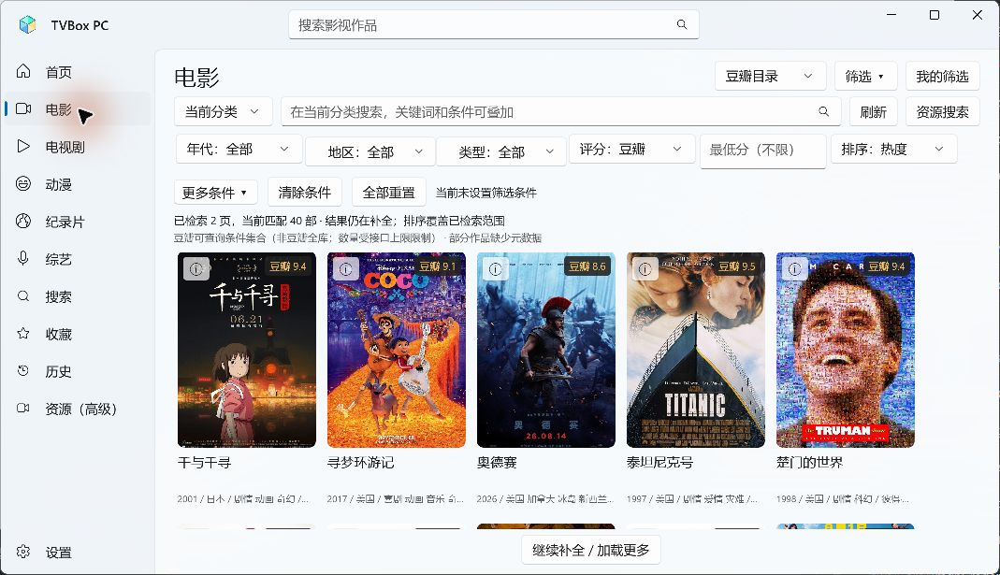

# TVBox PC v0.4.0 更新报告

日期：2026年11月6日。目标平台：Windows 11 x64，未签名免安装便携版。

本次把作品分类、查询筛选、影片详情与可选TMDB资料接入现有点播客户端。小雅/G-Box按用户最新要求移至下一次更新。本报告区分实现、实测和未执行项，完整逐项矩阵见[验收记录](../ACCEPTANCE-0.4.0.md)。

## 本次改动

| 变更 | 稳定标识/范围 | 用户可见结果 |
| --- | --- | --- |
| 新增分类 | `movie`电影、`tv`电视剧、`anime`动漫、`documentary`纪录片、`variety`综艺 | 统一海报目录，不按资源站充当首页。 |
| 修改搜索/本地列表 | `global:all`搜索、`favorites:all`收藏、`history:all`历史 | 共用筛选规则；资源原始搜索在高级入口保留。 |
| 新增组合筛选 | `CatalogQuery` | 年代/范围、地区与类型多选、评分体系/最低分/人数、排序、剧集状态、动画形式、关键词；清除条件保留关键词，全部重置恢复默认。 |
| 新增持久状态 | `metadata-v4.sqlite` | 保存完整已查询列表、条件、游标、位置、人工关联与筛选预设；可把预设固定到首页。 |
| 新增详情 | 海报ⓘ、播放器影片详情 | 原名/别名、地区、类型、年份、片长、演职员和剧情；普通海报点击仍直接选源。 |
| 新增分平台评分 | `douban`、`tmdb`、`imdb` | 分别显示评分、人数与获取时间；可靠ID才启用外链，不合成混合分。IMDb没有评分服务时显示暂无数据。 |
| 新增可选凭据 | 设置→影视资料与评分 | 个人TMDB Key/Read Token使用本机当前用户DPAPI加密；保存、删除、测试连接；不写入普通prefs或发布包。 |
| 新增安静提示 | `tmdb_hint_seen`、`tmdb_hint_hidden` | 只在首次主动使用可选资料时提示一次，支持不再提示，跨重启保存；缺Key不阻断豆瓣和普通播放。 |
| 扩展身份和搜索 | 提供方+影视类型+ID+季，原key保留 | 同名不同年、电影/剧集和不同季分别处理；别名搜索仍核对年份/类型/季数。低置信关联不自动绑定，可核对候选/解除TMDB关联。 |
| 预留高清接口 | `IHdSourceAdapter`、`HdSourceRegistry` | 详情与播放器有入口，明确说明小雅/G-Box下次接入，不扫描NAS、不转存、不让普通起播等待HD。 |
| 发布与组件 | 0.4.0、SQLite9.0.22/SQLitePCLRaw2.1.13 | 同步程序集/FileVersion，加入原生SQLite、许可及TMDB标识；排除凭据/数据库/用户记录。 |

原32个普通播放来源、来源key、默认配置身份及12个豆瓣/Netflix快捷集合key**未新增、未删除、未替换**。Netflix页明确为豆瓣Netflix标签片库，非Netflix官方实时榜单。资源浏览保留在“资源（高级）”。直播、AI、同步仍未加入。

## 验证结果

- 原76项行为断言保留，新增50项v0.4断言，共126项；严格Release x64编译0警告0错误。
- 全新隔离目录不填Key，豆瓣首页、分类和关键词搜索可用。电影“流浪地球”5部→豆瓣≥8后2部→科幻后1部；重启后条件和结果恢复。
- 滚轮触发第2页，20→40部；切收藏再返回，40部和位置保留。下图为本版实际UI。
- 详情实际获取125分钟、年份、地区/类型、别名、演职员、剧情及豆瓣人数。点过“不再提示”后，再打开播放器详情及重启均不重复。
- **实际播放**：《流浪地球》自动选源出画面，1920×756/H.264/HLS，播放至1分9秒；《庆余年 第一季》第01集出画面，1920×1080/H.264，观看约15秒。返回及重启后进度和收藏保留。测试前系统静音已回读确认。
- 自动覆盖缺Key零TMDB请求、401不重试/错误脱敏、429有界重试和冷却、SQLite重开/过期缓存/清理保护、旧收藏身份、季数与外链规则。
- ZIP检查要求无用户记录、日志、凭据或SQLite；独立报告与对应源码一起交付，SHA256见同版本校验附件。

## 已知限制与未验证

1. 未提供个人TMDB凭据，**真实认证联网搜索、详情关联、多季选择和外链尚未实测**。协议和异常测试通过不等于这些真实流程通过；普通豆瓣点播已实测。
2. 分类查询明确披露范围：豆瓣最多扫描1000候选、TMDB最多500页。显示当前匹配/已扫描范围，局部补全排序不称全库榜单。未知字段无条件时保留，指定条件会排除未知；未知年份可明确纳入。
3. F-03/F-04/F-06及完整三源手动切换、故障注入、浏览器外链等矩阵中未执行的人工步骤均已在验收表标明。没有以126项断言冒充全部GUI验收。
4. 小雅/G-Box延期；本版无真实高清云端候选、NAS账号或转存功能。IMDb分数服务未接入。
5. 第三方视频可能含片内广告、水印和缓冲；探测耗时不是Ping，高清优先不是全网最高画质保证。未执行长时稳定性、RTX5080/4K/HDR、直播、MSI或自动更新验收。

## 数据与升级

完整解压到新的程序目录，先退出旧版再运行根目录TVBox.exe。**保留用户资料目录** `%LOCALAPPDATA%\TVBox PC`；没有以清空收藏/历史/设置作为升级步骤。原JSON记录及key继续使用，新增SQLite只承载资料/查询，不替换原收藏和历史。清理资料缓存保留预设与人工关联，凭据不随JSON备份跨Windows账号迁移。首页原推荐瀑布流保留到本次程序退出，新分类查询状态可跨重启恢复。

## 交付位置

- 本地程序：`artifacts/TVBox-x64-0.4.0/TVBox.exe`。
- 便携ZIP：`TVBox-x64-0.4.0.zip`。
- 完整对应源码：`TVBox-PC-0.4.0-source.zip`；不要把下载仓库自动生成的Source code当作对应工程。
- 校验附件：`RELEASE-SHA256SUMS.txt`；本报告作为独立 `.md` 附件。
- [私有下载页](https://github.com/cbdoglolz/tvbox-pc/releases/tag/v0.4.0)；[便携ZIP](https://github.com/cbdoglolz/tvbox-pc/releases/download/v0.4.0/TVBox-x64-0.4.0.zip)。需要具有私有仓库访问权限的GitHub账号。

开发依据：[TMDB认证](https://developer.themoviedb.org/docs/authentication-application)、[TMDB署名要求](https://developer.themoviedb.org/docs/faq)。开发与发行阶段分别执行；远程附件完整下载校验结果记录在发布验证日志。
