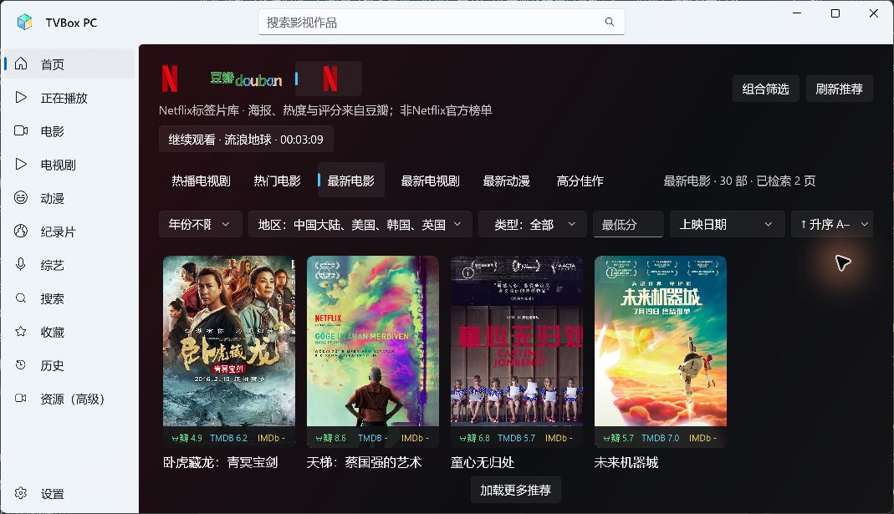
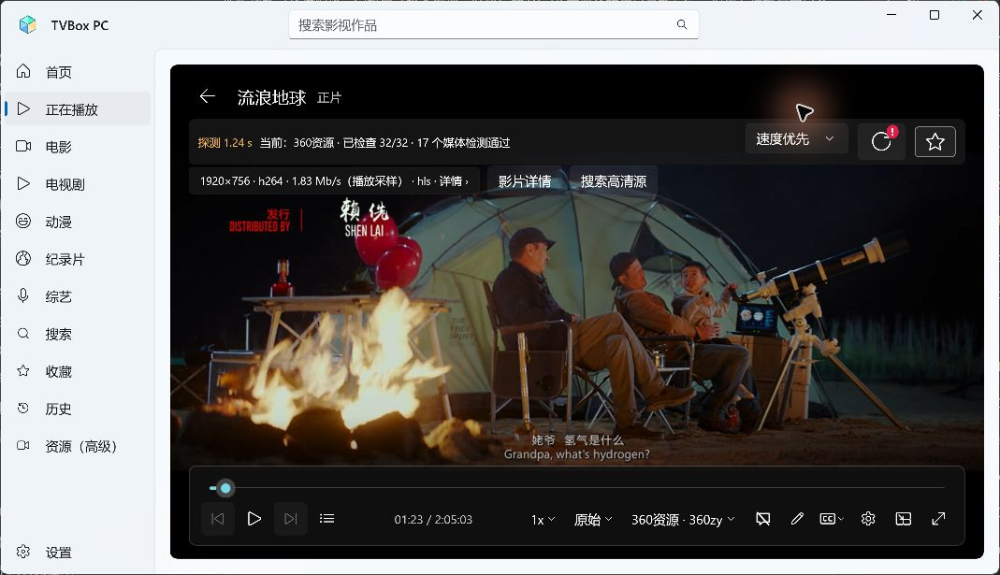
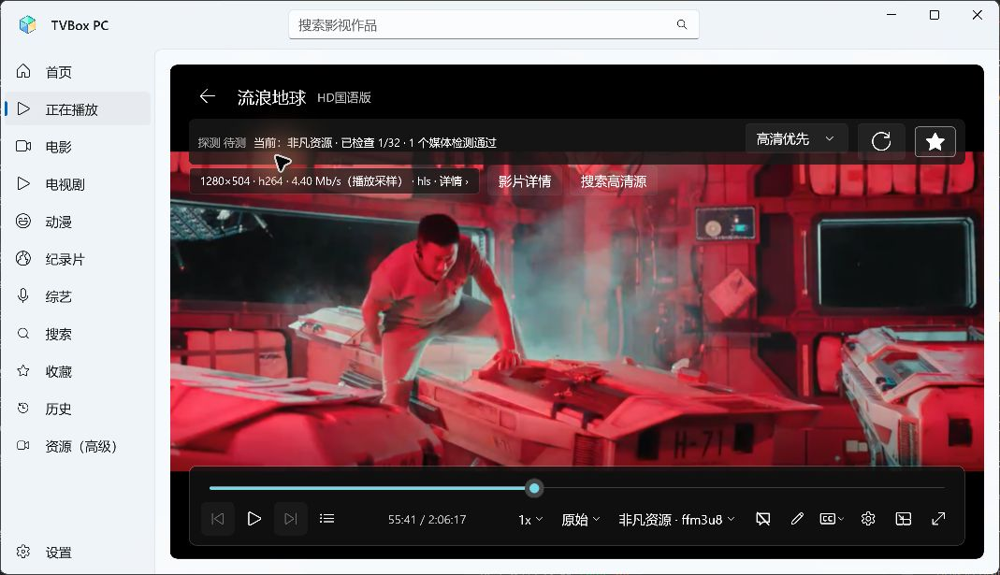

# TVBox PC v0.5.0 更新报告

日期：2026-11-06。目标：Windows 11 x64、鼠标键盘点播。本次为0.4.0后的功能及稳定性更新。

## 本次改动

| 项目 | 实现后的行为 |
| --- | --- |
| 常驻播放页 `player` | 首页、分类、搜索与设置独立于播放器；切走继续后台播放，侧栏“正在播放”返回同一会话。换片或退出才销毁旧会话。 |
| 续播与选源 | 先单独连接历史中最后成功的来源和资源ID；恢复实际视频及进度后停止自动补源。失败再按速度/高清偏好检测其余来源；底部仍可手动补充和切换来源。 |
| 播放器顶部 | 去掉重复的手动来源入口；偏好右侧为刷新图标，更改偏好后有红色叹号和立即刷新提示；右侧方框五星可收藏/取消，反馈“已收藏/未收藏”。刷新保留影片、当前集及已确认进度。 |
| 首页品牌 | 豆瓣使用官网原图、浅绿白背景和深色文字；Netflix使用官网N标、深红黑背景和浅色文字。切换仅180毫秒淡入，遵循系统动画开关，无大背景图或循环动画。Netflix仍为豆瓣标签片库，非Netflix官方榜单。 |
| 首页筛选 | 在当前频道原地筛选年份、地区、类型、最低豆瓣分；热度、年份、上映日期、评分、名称均可升/降序。不同频道保留各自结果、条件和位置。未知数值排最后；排序覆盖已检索范围，继续滚动可补全。 |
| 海报评分 | 贴海报底部横条，从左到右显示豆瓣、TMDB、IMDb独立分数；缺失用短横线`-`。移除海报顶角旧分数和海报下的附加评分文字。 |
| 后台资料 | 保存个人TMDB凭据后，已加载海报自动补齐资料，最多两项并发，不必点详情；切频道取消旧请求，回首页可继续补齐。Key仍选填、加密保存且不回显。 |
| 悬停注释 | “当前分类/全局影视”改为“仅本分类/全部电影和剧集”；搜索范围、评分、排序、年份及相关控件悬停可查看含义。 |
| 输入与退出稳定性 | 相同勾选状态不重建复选框，筛选更新移到输入事件之后；资料更新复用海报对象；标题栏输入区域在窗口销毁前清理，避免Closed后再访问原生输入对象。 |
| 基础组件与打包 | Windows App SDK升级为2.6.5；WinUI原生组件、PRI与MUI同置`libs`，同步根程序激活清单，修复新SDK沿用旧便携布局时的启动失败。 |

“全部电影和剧集”表示跨影视内容类别搜索，**不表示全网站、所有播放源或NAS文件搜索**。原有年份、地区等筛选仍生效。

原32个普通来源及稳定key、默认配置身份、12个豆瓣/Netflix集合key均未新增、删除或替换。新增静态品牌文件为`assets/icons/douban.png`、`assets/icons/netflix.svg`，来源及商标说明在THIRD-PARTY-NOTICES.md。小雅/G-Box继续延期；未加入直播、AI或同步。

## 故障原因与修复依据

1. **切页丢播放器是确定的生命周期错误。** 原播放器嵌在业务Frame中，回首页会导航离开、执行清理并释放解码器。现在所有播放请求统一交给独立PlaybackFrame；切页只隐藏并保存进度。
2. **续播过早报成功和覆盖进度已复现。** Flyleaf会在真正定位完成前先修改时间轴；旧帧和跳到目标的数字不能证明目标画面已恢复。现在需定位成功、缓冲结束、目标附近的新视频帧继续前进，才提交进度及成功来源。失败候选保留原历史。
3. **长进度HLS另有时间戳跳变。** 同一55分钟测试分片的播放列表时间与PES时间戳约差37秒；诊断确认FFmpeg继续读取目标后的分片，旧15秒读取上限提前中断。初始续播改为精确定位，单独提供45秒读取/定位上限、60秒起播检查；优先来源阶段最长65秒，均可取消。成功后恢复普通读取上限。无记录的普通起播仍按20秒检查，普通拖动保留8秒定位检查。
4. **用户闪退证据边界。** Windows应用事件确认0.4.0在11:26:49于`Microsoft.UI.Input.dll`发生`0xC0000005`。现存WER只有报告、没有原生转储，无法据此证明唯一调用栈。本次修正代码中可确认的输入控件重建、窗口销毁后调用输入API等风险，同时升级包含输入/退出修复的WinUI；本轮验收未再记录TVBox访问冲突。不能把这写成所有来源、所有机器永不崩溃的保证。

SDK依据：[Microsoft发布说明](https://github.com/microsoft/WindowsAppSDK/releases)、[焦点TextBox退出问题](https://github.com/microsoft/microsoft-ui-xaml/issues/11653)。上游记录支持修复方向，不代替本机原生崩溃栈。

## 实际验证

测试使用隔离资料目录，系统默认输出**已静音并回读确认**；没有向用户原始历史加入测试影片。TMDB验证使用当前Windows用户已保存的加密凭据，不读取或公开明文。

- **149项行为断言通过**：原126项保留，新增23项，控制台另1行汇总不计入断言。覆盖优先来源阶段只请求一个站、失败后排除已尝试站、双向排序与未知值、中文名称顺序、三评分独立值、元数据原地更新、持久查询、长进度验证与进度保护。严格Release x64编译0警告0错误。
- **后台播放**：《流浪地球》1920×756/H.264实际出画面；播放中依次去首页、设置，再回“正在播放”。历史位置从约14秒持续推进到47秒，媒体打开次数保持1次，没有重新起播。之后继续运行并切页、筛选约6分钟。
- **刷新和收藏**：高清改为速度时出现红叹号及提示，五星点击反馈已收藏；刷新后从另一来源恢复到原1分23秒并继续播放。底部手动列表可打开，优先续播成功后从该列表按需补充其他来源，不抢换当前影片。
- **长进度真实续播**：隔离QA将历史设为55:00（不是连续观看55分钟），保存来源为非凡资源。新版优先恢复该源，实际画面从55分钟继续推进到55:41，历史位置随之更新；自动检查保持1/32，没有先播放其他源。该带时间戳跳变样本约40秒完成连接、解析与定位；失败测试保留55分钟原记录。
- **首页实测**：豆瓣浅色与Netflix深色、官网标志均显示；没有点击影片详情，海报已自动出现豆瓣与TMDB两个不同分值，例如豆瓣8.0/TMDB8.3、豆瓣6.4/TMDB6.6；IMDb为`-`。地区连续5次勾选、日期改升序后仍留在首页；实际候选从2016年开始排列。
- **瀑布流**：豆瓣20→40部由滚轮触发；切设置返回仍40部并恢复位置，关闭重开也保留40部。Netflix条件与30部结果独立保留。
- **窗口和退出**：全屏及恢复普通窗口通过；播放器返回首页仍有“正在播放”。带搜索框焦点正常关闭，多轮启动/切页/筛选/续播后复查Windows应用错误，未出现新的TVBox访问冲突事件。
- **剧集回归**：《庆余年 第一季》第01集实际1920×1080/H.264播放，选集切第02集后从零起播并推进到52秒；原电影55:41记录保持不变。换片释放旧会话，季与集数没有串到另一作品。
- **便携入口**：升级SDK后曾复现旧布局启动失败`0xC000027B`；同目录资源布局修正后，实际从便携包根TVBox.exe启动并完成上述播放检查。

## 限制与未验证

- 原生崩溃无转储，尚不能确认用户此前每次闪退是否同一原因；本轮短期实测和事件复查不能代替数天持续运行。
- HLS时间戳跳变/片内广告会增加定位时间，不能保证所有第三方来源均支持准确拖动；超时会保留记录并换源。分辨率和媒体探测通过不代表没有广告、水印或后续缓冲。
- TMDB自动关联只接受可靠唯一匹配；未匹配用`-`，分季豆瓣分与TMDB整剧分不混同。IMDb评分服务尚未接入。未遍历所有影片、所有TMDB/IMDb外链及所有季数。
- 排序是已检索候选的有序结果，不是获取豆瓣/Netflix全部影片后的全库榜单；豆瓣最多1000候选、TMDB接口最多500页的范围提示保留。
- 未新增或验收RTX5080/4K/HDR、长时音画同步、自动更新、同步、直播或AI。包为未签名便携版；MSI未交付，上游安装脚本仍需适配TVBox PC名称和新WinUI布局。

## 数据与交付

完整解压新版目录后运行根TVBox.exe，升级前退出旧版。收藏、历史、配置和加密TMDB凭据继续保存在`%LOCALAPPDATA%\TVBox PC`；原JSON为权威记录，新增查询缓存不替换它们。没有清空用户数据或改动默认来源身份。

- 本地程序：`D:\tvboxwin\artifacts\TVBox-x64-0.5.0\TVBox.exe`。
- [私有下载页](https://github.com/cbdoglolz/tvbox-pc/releases/tag/v0.5.0)、[便携ZIP](https://github.com/cbdoglolz/tvbox-pc/releases/download/v0.5.0/TVBox-x64-0.5.0.zip)。需要具有仓库权限的GitHub账号。
- 完整对应源码：`TVBox-PC-0.5.0-source.zip`，不是下载仓库自动生成的Source code。
- 本报告作为同版本独立MD附件；校验文件为`RELEASE-SHA256SUMS.txt`。包内同时保留旧版本验收及报告。
- 本地构建/打包/远程校验证据保留于`artifacts`，不随包公开开发日志、历史、凭据或SQLite。
