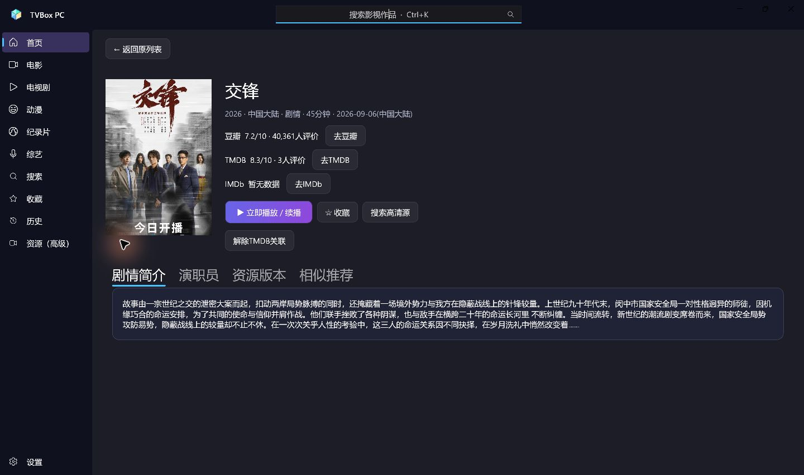
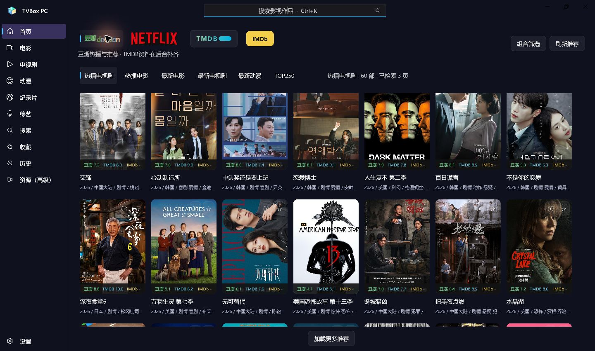
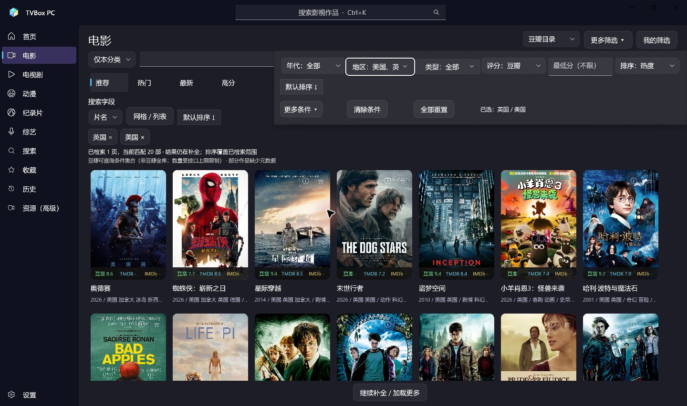
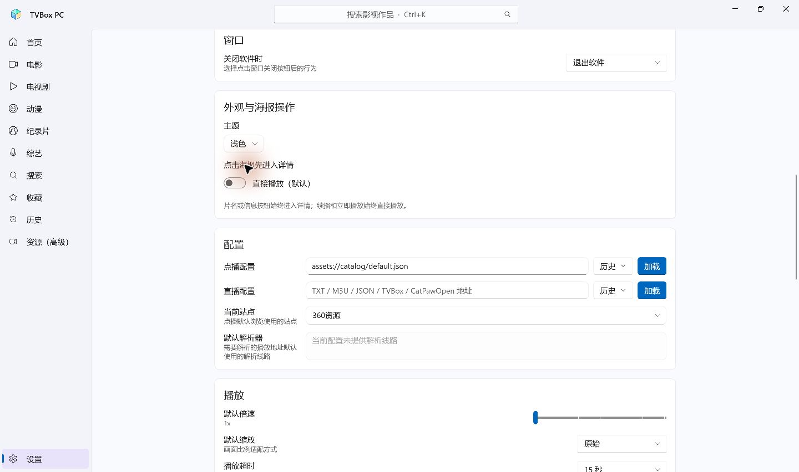
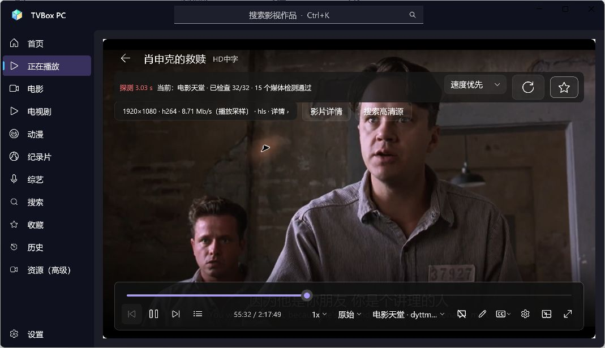
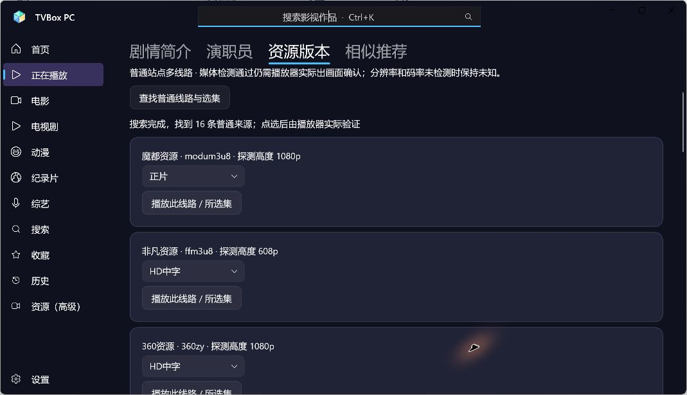

# TVBox PC v0.6.0 更新报告

日期：2026-11-06。目标平台：Windows 11 x64，鼠标/键盘点播。基于 0.5.0，按 UI/UX 改版规范 v1.0 与 8 张参考图实施。本报告区分代码实现、实际观察和未验证范围。

## 已实现

| 项目 | 本版行为 |
| --- | --- |
| 统一外观 | 深海紫蓝深色、完整浅色和随品牌切换三种模式；统一页面背景、按钮、圆角、卡片和焦点。新资料目录默认深色；已有配置升级保留品牌主题行为。外观和海报点击设置位于设置页顶部。 |
| 全局导航 | 保留首页、正在播放及各媒体频道、搜索、收藏、历史、资源、设置；窄窗口自动收起文字栏，不覆盖用户的展开偏好。Ctrl+K 聚焦全局搜索，保留系统窗口按钮与拖动区。 |
| 发现首页 | 豆瓣、Netflix 横向标识，TMDB目录入口与IMDb能力说明；真实推荐主卡、剧情、三平台独立评分、继续观看、热播电影/剧集、动漫、TOP250/高分预览行及频道海报墙。预览行限量，频道网格持续加载。 |
| 品牌与数据含义 | Netflix仍是豆瓣Netflix标签目录，界面标明非Netflix官方榜单。TMDB目录需选填个人Key；不配置仍可普通看片。IMDb当前没有独立榜单/评分服务，可靠ID只用于外链。 |
| 分类与筛选 | 电影、电视剧、动漫、纪录片、综艺的推荐/热门/最新/高分二级菜单；原地筛选浮层、地区/类型多选、条件标签删除、保存/更新/删除筛选、网格/紧凑列表。显示已检索页数、当前数量与结果范围。 |
| 排序 | 取消方向下拉菜单，使用一个按钮循环“默认→正序→逆序→默认”；默认恢复栏目排序，不清空条件。旧布尔方向预设兼容读取；服务端与本地排序使用同一有效状态。 |
| 统一海报操作 | 海报主体默认直接播放；信息图标和片名进入详情；续播始终直接播放；收藏按钮提供已收藏/未收藏反馈。可在设置改为海报先进入详情。首页/分类/搜索/收藏/历史复用同一作品卡片。 |
| 完整作品详情 | 独立内容页展示资料、三平台独立评分及人数、可靠外链、剧情、演职员、可获取的季信息、普通来源与选集、按类型/题材的推荐。原资源站详情路径保留。缺资料、无外部ID、IMDb缺分均有明确状态。 |
| 资源与播放入口 | 普通播放不等待云盘；详情页主动查找普通来源，可选择来源和集数。手动选择优先使用所选来源；普通续播仍优先上次成功来源，失败后按偏好换源。小雅/G-Box未接入状态明确显示。 |
| 播放器 | 沿用Flyleaf/FFmpeg及现有播放会话，只统一控件圆角和紫色进度强调；播放器的作品详情进入同一个完整详情页，继续后台播放。原字幕/音轨/倍速/选集/全屏和底部手动选源入口保留。 |

演员/导演的远程检索尚未接入，搜索字段中明确禁用，当前使用片名搜索；不会暗中把演员输入当作片名请求。相似推荐当前是实际目录中的类型/题材推荐，不宣称官方相似榜。无可靠季/集资料时，不补造季集结构；实际来源查找后可选择其提供的集数。

## 修复原因与数据保护

1. **评分回退已复现并追到数据层。** 从JSON缓存恢复时，候选列表和显示列表是两份对象。只给显示列表补TMDB资料，下一次从旧候选重新筛选就会把评分、简介覆盖回旧值。新增统一状态补齐方法，同时更新两份对象和推荐行；新增行为断言验证补分后重新筛选仍保留分数及简介。
2. **三状态排序需要兼容旧状态。** 旧版只有升/降序布尔值，本版增加默认状态与栏目默认字段，同时保留旧字段读取；缓存读取兼容0.5.0旧键，避免升级后已加载海报和位置被当作不存在。
3. **独立详情页不能替换原列表实例。** 新增独立详情Frame和统一作品操作，进入前保存列表状态，返回激活原页面；独立PlaybackFrame保留。离开详情取消其未完成的查询，避免结果回写其他作品。
4. **窄窗口浮层和列表需要单独布局。** 实测发现筛选内容超过浮层默认宽度、紧凑海报内三评分挤在一起；筛选宽度改为随窗口约束并换行，列表评分移到资料栏。

没有清空或覆盖用户收藏、历史、默认配置身份、来源key和TMDB凭据。新增外观偏好与查询状态为增量数据；原JSON记录仍是收藏/历史/配置的权威来源。

## 来源、栏目与标识变化

- **播放源未变更**：原32个普通来源及稳定key没有新增、删除或替换；`assets://catalog/default.json`身份保留。
- **原集合未变更**：豆瓣 `hot-tv`、`hot-movie`、`new-movie`、`new-tv`、`anime`、`top250`；Netflix `hot-tv`、`hot-movie`、`new-movie`、`new-tv`、`anime`、`top-rated`，完整key分别保留`douban:`和`netflix:`前缀。
- **新增详情路由**：`work-details`，名称“作品详情”；原资源站详情及`player`会话未删除。
- **新增频道内查询范围**：下表为页面查询范围，不是新增片源。

| 频道名称 / 稳定标识 | 推荐 | 热门 | 最新 | 高分 |
| --- | --- | --- | --- | --- |
| 电影 `movie` | `movie:recommended` | `movie:hot` | `movie:latest` | `movie:rating` |
| 电视剧 `tv` | `tv:recommended` | `tv:hot` | `tv:latest` | `tv:rating` |
| 动漫 `anime` | `anime:recommended` | `anime:hot` | `anime:latest` | `anime:rating` |
| 纪录片 `documentary` | `documentary:recommended` | `documentary:hot` | `documentary:latest` | `documentary:rating` |
| 综艺 `variety` | `variety:recommended` | `variety:hot` | `variety:latest` | `variety:rating` |

新增静态资产`netflix-wordmark.jpg`来自[Netflix官方品牌页](https://brand.netflix.com/en/assets/logos/)的横向Wordmark原图；官网来源及商标说明已写入THIRD-PARTY-NOTICES。原豆瓣、TMDB及Netflix N资产保留。IMDb入口使用文字标识，不称为新增IMDb接口。

## 已实际验证

- **176项行为断言通过**：原149项保留，本版新增27项；控制台另外1行汇总，不计入断言数。覆盖排序循环、栏目默认值、旧预设、缓存兼容、页面位置、主题迁移，以及补资料后重新筛选不丢评分/简介。严格Release x64编译0警告、0错误。
- **可运行界面**：从自带私有运行库的便携目录启动，实际显示首页、分类、独立详情及设置；不是静态预览图。
- **真实资料**：未先打开详情，首页已经出现豆瓣8.0/TMDB8.3等独立评分和实际剧情；IMDb缺分保持`-`。重复调整窗口、切页和返回后评分仍保留。
- **瀑布流与返回**：滚轮从20→40→60部，显示3页；打开《交锋》详情后返回仍60部及原位置。隔离资料库记录60条、3页及原滚动偏移，重启后60部保留。不同宽度下列数变化会改变同一像素偏移处显示的卡片。
- **详情与点击偏好**：点击片名进入完整详情，无强制播放；实际展示独立分数、人数、剧情和可用外链状态。设置“海报先进入详情”后点击海报主体仍进入详情，默认直接播放的开关可恢复。
- **筛选与排序界面**：实际执行三状态循环；美国/英国同时勾选后显示两枚条件标签，结果在电影页原地更新。高级浮层完整展示可用控件，未跳到其他页面。网格/紧凑列表均实际打开。
- **主题**：深色和浅色实际切换，文本、侧栏、设置控件及海报均可读；显式浅色下回首页仍为浅色。
- **长进度与后台播放**：隔离测试将《肖申克的救赎》历史设为55:00（并非连续观看55分钟）。首先连接原魔都来源，定位超时后自动尝试其他来源，电影天堂实际1920×1080/H.264出画面并继续到57分钟。播放中切首页、设置、回正在播放，媒体打开次数保持本轮2次（原失败尝试+成功来源），没有因切页再次打开。空格暂停已实测。
- **详情手动选源**：主动查找得到16条普通来源候选，仅表示检测/解析候选，不等于16条均已实际播放。手动选择360来源后，播放器显示优先连接所选来源，实际恢复57分钟附近进度并出画面，成功后结束自动补源，没有继续使用先前电影天堂线路。
- **剧集与全屏**：搜索《庆余年 第一季》后，海报直接播放非凡来源第01集，实际1280×720/H.264。切第02集从00:00起播并持续到12:12后暂停；电影58:31进度独立保留。按钮全屏、Esc恢复普通窗口观察通过。
- **搜索快捷键**：Ctrl+K实际聚焦全局搜索；输入剧集名提交后进入搜索结果，关键词保留为条件标签，返回与进一步筛选使用同一查询范围。

以下为本轮实际验收截图；部分截图早于最终背景统一和设置区位置调整，功能及数据为当时真实运行结果。

播放与最终包验证记录见`docs/ACCEPTANCE-0.6.0.md`。播放验收使用隔离资料目录；系统静音状态会单独记录。交互检查中曾在静音核查前意外触发一次隔离播放，不能把这一段写成预先静音。

## 未做 / 未验证与限制

- 未增加小雅/G-Box、云盘登录/转存、NAS、AI、直播、同步、安装器或自动更新；普通来源优先策略与云盘高清搜索分开。
- 未接入IMDb独立评分和发现服务；没有评分时不作伪造。没有可靠外部ID时禁用外链。多平台目录并非所有作品都有所有字段。
- 查询受提供方范围和接口限制；本地排序只覆盖已检索候选，不是全站/全库排名。当前推荐与热门可能来自同一提供方热度目录，不伪造额外榜单。普通作品筛选不加入未经资源探测的4K/HDR属性。
- 未完成外挂字幕加载、多音轨切换、倍速切换的本轮实机验收；字幕文本处理断言通过且原代码保留。未完成所有分辨率/DPI组合、数天连续运行、全部32源全部影片、RTX5080/4K/HDR、全部字幕音轨格式的专项验收；短期操作无崩溃不等于永久保证。
- 短时观察过隔离资料下的进程内存，尚未做同条件0.5.0对照及长时间泄漏测试；不承诺内存优化百分比。
- 原生闪退的既有修复继续保留；没有新的原生转储时，不能给每种故障编造调用栈或保证第三方来源持续可用。

## 程序、资料与交付

- 本地程序：`D:\tvboxwin\artifacts\TVBox-x64-0.6.0\TVBox.exe`。
- 便携包：`D:\tvboxwin\artifacts\TVBox-x64-0.6.0.zip`，完整解压后运行根TVBox.exe。
- 对应源码：`D:\tvboxwin\artifacts\TVBox-PC-0.6.0-source.zip`；校验：`D:\tvboxwin\artifacts\RELEASE-SHA256SUMS.txt`。
- 本报告为独立MD文件；本版未发布新的GitHub Release，不提供尚未验证的下载网址。
- 升级前正常退出旧版；收藏、历史、设置和加密凭据继续保存在`%LOCALAPPDATA%\TVBox PC`。测试均使用隔离目录，没有向个人记录写入测试影片。0.5.0验收与更新报告保留归档。
