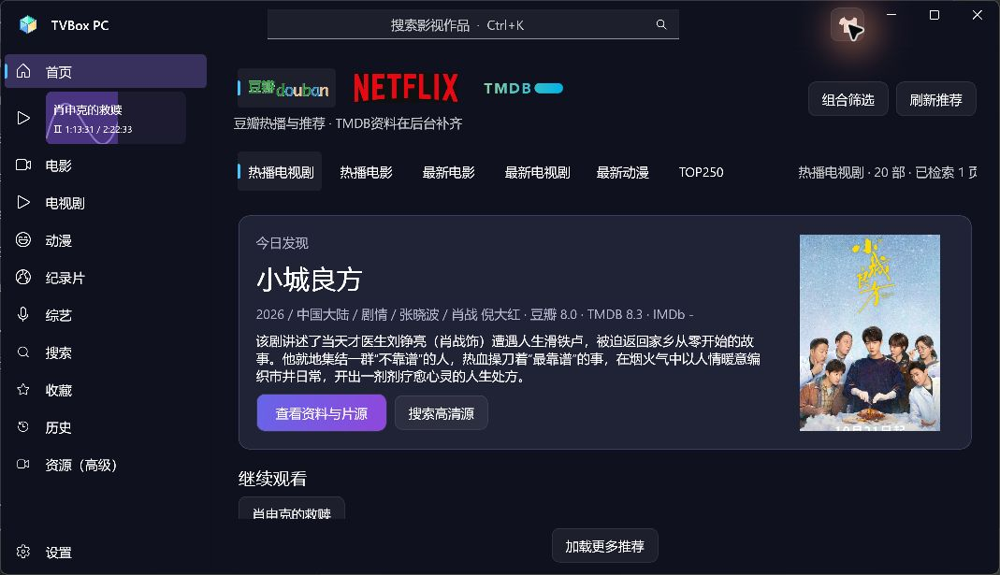
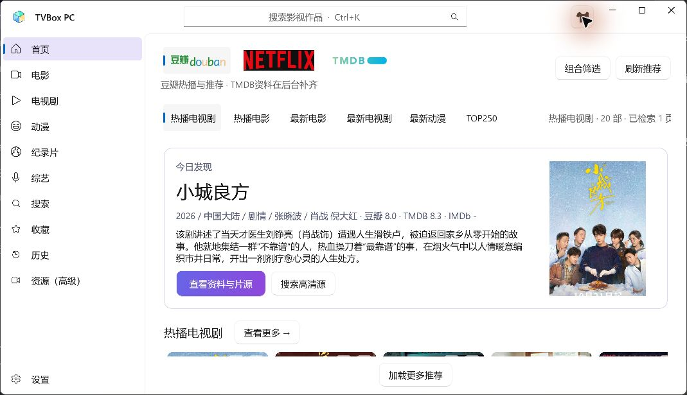
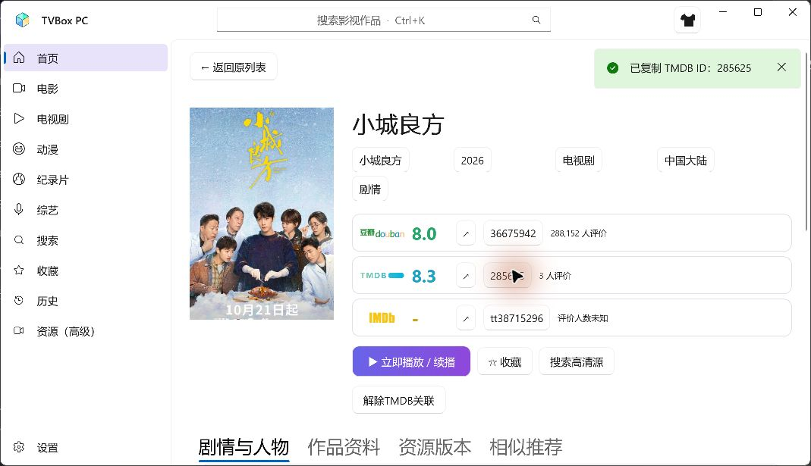
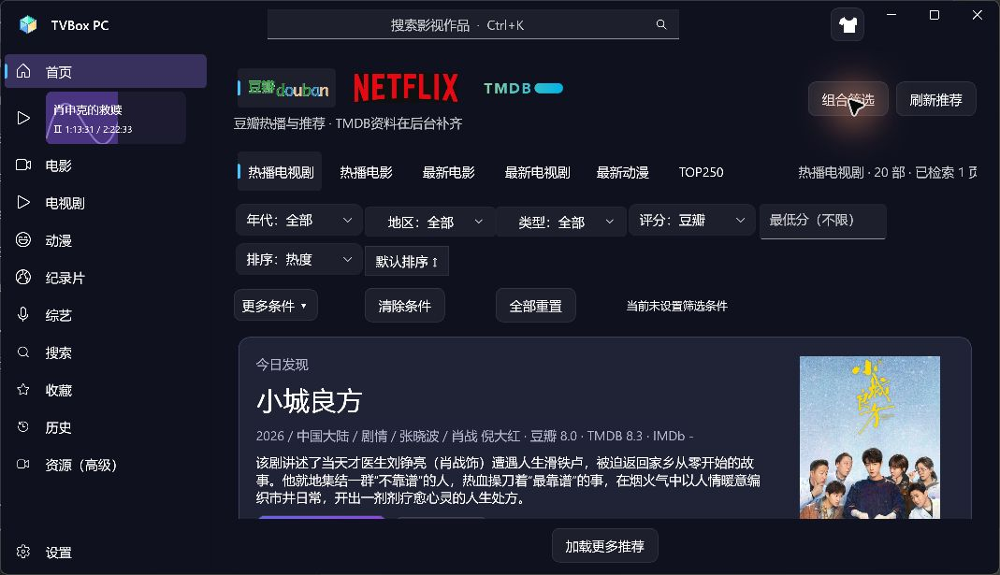
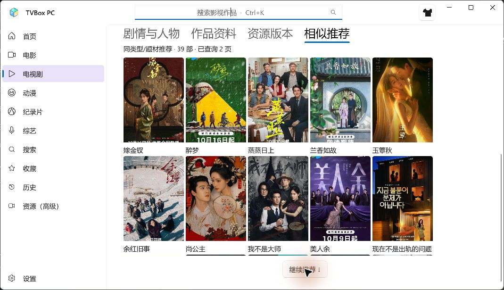
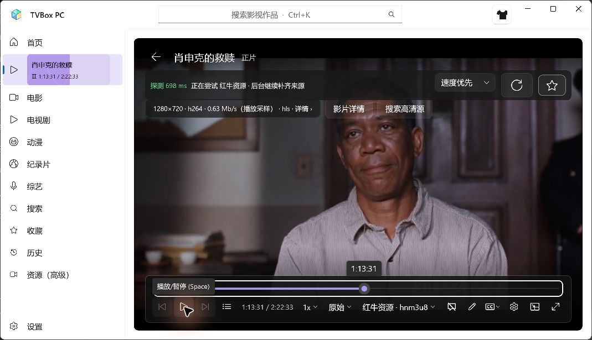

# TVBox PC v0.7.0 更新报告

日期：2026-11-07。目标：Windows 11 x64。基于0.6.0，统一发现、详情、人物作品与筛选体验，并减少平台切换时的重复工作。以下分别记录实现、实测与限制。

## 本次已实现

- 首页顶部只保留豆瓣、Netflix标签、TMDB三项，TMDB也在首页原地切换，不再跳到另一种目录页。Netflix依然是豆瓣提供的Netflix标签片库，不冒充官方榜单。
- 外观仅有“奈飞·蓝黑紫”和“豆瓣·纯白”，右上角衣服按钮一键切换；选择资料平台不改变主题。显式设置系统最小化、最大化、关闭按钮在深浅主题下的前景、悬停及非活动颜色。设置页同步这两种选择。
- 海报、片名、列表续播以及高级资源搜索结果先进入作品或片源详情；只有详情内的播放/线路按钮确认后才播放。原有自动选源、优先续接、手动换源和后台播放保留。
- 作品详情显示中文简介优先、人物头像及真实角色关系。提供方有角色名时显示“演员饰演角色”，没有时标记演员，不猜测角色。点击头像按可靠TMDB人物ID打开参演片库；豆瓣人物需唯一精确姓名匹配，歧义时不自动关联。
- 详情评分使用豆瓣、TMDB及IMDb对应标志和绿/蓝/金色分值；缺分保留短横线。外链使用斜向箭头，旁边显示作品ID；点击ID写入剪贴板并显示成功/失败提示。IMDb仍没有独立评分服务。
- 片名、年份、电影/剧集、已映射地区和类型为可点击条件，进入列表时直接应用相应筛选。增加来源页面返回按钮。
- 首页“查看更多”打开独立的推荐片库，分页和滚轮继续加载；详情相似推荐增加“继续推荐”，追加结果并去重。
- 首页与目录、搜索、人物片库、推荐列表使用同一个筛选控件、查询模型和条件标签：范围、年代/起止年、地区多选、类型多选、评分体系/最低分、评价人数、状态、动画形式、排序字段与三状态方向。清除条件保留片库身份，人物条件可单独移除。人物资料提供方锁定TMDB，选择全局范围会明确移除人物限制。
- 左侧正在播放显示真实会话片名、进度前景/背景和当前/总时间；播放时紫色曲线移动，暂停或缓冲时停止。长标题支持走马灯，尊重系统关闭动画的设置。每秒更新，不建立第二个播放器。

筛选结构参考[Emby官方目录/排序模型](https://dev.emby.media/doc/restapi/Browsing-the-Library.html)及[字段筛选说明](https://dev.emby.media/reference/RestAPI/ItemsService/getItems.html)的范围、字段、方向分离方式；本版没有连接Emby服务器。

## 卡顿与稳定性处理原因

原实现每次平台/筛选切换都会补资料，同步反序列化查询状态，单页资料逐项写SQLite，且隐藏目录仍可能继续请求。此次增加会话查询热缓存、已成功补资料的短期去重、推荐行复用、相关缓存批量事务和SQLite连接复用，并在离页时取消旧查询。返回时恢复已有列表和位置。

海报原来按原图解码，同图可能重复下载/解码；现在合并相同图片请求，最多4项并发，解码宽度限制为384物理像素，内存LRU从256项调整到128项。已加载页面仍引用自己的海报，不用清空瀑布流换取内存下降。此处没有承诺总内存下降百分比。

本轮未发现新的Windows TVBox原生崩溃事件或新异常会话记录，不能声称已经根治所有闪退。新增本地会话启动/退出状态、异常类别和带日期/PID的日志，供后续把正常退出、托管异常和原生异常分开核查。会话记录不包含片名、地址或凭据；没有人为制造原生崩溃，异常与正常关闭的完整路径未做实机覆盖。共享交互实例未被自动终止。

## 实际验证

- 自动回归189项行为断言通过：原176项加13项人物/缓存/中文简介等断言；控制台另有1行汇总，不能计为第190项断言。严格Release x64编译0警告、0错误。
- 真实WinUI界面观察：顶部无IMDb按钮，豆瓣/Netflix/TMDB原地切换；衣服按钮切换纯白与蓝黑紫，系统窗口按钮在两种主题下可见；白色主题切到Netflix仍保持白色。实际窗口1069×615。
- 三次平台切换的同步界面路径记录为77.6、56.0、54.8毫秒，分别涉及Netflix、TMDB和已加载豆瓣返回；不含网络等待，也不是全机器性能保证。单作品测试夹具100次查询恢复曾测得冷读取5.88ms、会话命中0.46ms，不能据此宣称整机性能提升相同比例。
- “查看更多”实际打开独立列表；点海报进入完整详情。确认播放前，隔离会话媒体打开次数为0。中文剧情、角色卡片及官方IMDb PNG均实际显示，复制TMDB ID出现“已复制”提示。
- 点击演员头像实际打开“肖战·参演作品”，返回34部已加载结果，电影/剧集按人物ID查询。年份2026按钮进入带“年份2026–2026”标签的列表，返回按钮回到原详情。
- 相似推荐实际从19部、1页追加到39部、2页；排除当前作品并保留先前结果。首页同一套筛选字段实际展开，搜索结果保留片名条件标签。
- 电影《肖申克的救赎》由详情确认后实际播放，魔都来源1920×1080/H.264；侧栏时间从00:19前进。主动定位至1:12:30后，原来源超时、爱奇艺来源打开失败，红牛来源1280×720/H.264在目标附近恢复画面并前进到1:13:31。不是连续观看73分钟，也不是所有来源均成功。
- 暂停后实际画面及侧栏保持1:13:31，侧栏出现暂停符号；回首页继续保留该会话。暂停/缓冲停止波纹的逻辑保留，截图显示暂停状态。首次实机阶段后又小幅调整了长标题测量、初始空进度及辅助功能名称，这些调整通过最终编译，长标题走马灯未单独做完整实机样本验收。
- 所有本轮界面测试使用`.tools`下独立QA目录，启动前回读`TVBOX_PC_DATA_DIR`；仅复制现有加密TMDB凭据用于同账户测试，未打印或交付凭据。播放前重复执行默认系统输出静音并回读true。保留用户原0.6.0实例，未自动终止任何交互式TVBox进程。

## 来源、栏目与标识

播放源未新增、修改或删除：原32来源及稳定key、`assets://catalog/default.json`身份保留。原12个集合未变更：豆瓣`douban:hot-tv`热播电视剧、`douban:hot-movie`热播电影、`douban:new-movie`最新电影、`douban:new-tv`最新电视剧、`douban:anime`最新动漫、`douban:top250`TOP250；Netflix标签`netflix:hot-tv`热播电视剧、`netflix:hot-movie`热门电影、`netflix:new-movie`最新电影、`netflix:new-tv`最新电视剧、`netflix:anime`最新动漫、`netflix:top-rated`高分佳作。

新增首页TMDB查询栏目（不是播放源）：

| 标识 | 名称 |
| --- | --- |
| `tmdb:hot-tv` | 热门剧集 |
| `tmdb:hot-movie` | 热门电影 |
| `tmdb:new-movie` | 最新电影 |
| `tmdb:new-tv` | 最新剧集 |
| `tmdb:anime` | 动画作品 |
| `tmdb:top-rated` | 高分作品 |

新增人物查询范围`person`，实例标识为`tmdb-person:<人物ID>`；新增详情条件范围`facet`、独立推荐列表范围`collection`。移除首页IMDb导航按钮；详情IMDb标识、可靠ID和外链保留。IMDb标志来自[官方品牌工具包](https://brand.imdb.com/)，未新增IMDb评分接口。

## 未做/未验证与遗留

- 没有进行数天运行、所有来源/影片、完整分辨率/DPI矩阵或同条件0.6.0整机性能对照。第三方403、TLS/DNS、媒体格式和长定位失败仍可能出现，不等于全部候选都可播放。
- 部分角色名或演员名仍是资料提供方返回的外文；未接入翻译服务。没有可靠中文简介时显示缺失状态，不把纯英文剧情直接标成中文。部分未映射的细分类目只作为原始资料展示。
- 人物片库需选填TMDB Key，不填仍能普通看片；同名人物无法唯一确认时给出提示。TMDB剧集角色目前沿用普通credits接口的返回范围，不承诺跨全季角色完整性。
- 相似推荐按类型/题材查询，不冒充平台官方相似算法；排序仅覆盖说明中的已查询范围。
- 字幕、多音轨、倍速、4K/HDR与RTX专项没有在本轮重新覆盖。小雅、云盘、AI、同步、直播、MSI及自动更新未加入。
- 原异机Runtime提示按用户指令暂停专项排查；运行包仍包含私有.NET，不把本机启动当作另一台电脑已验收。

## 程序、下载和升级

- EXE：`D:\tvboxwin\artifacts\TVBox-x64-0.7.0\TVBox.exe`。
- 完整运行包：`D:\tvboxwin\artifacts\TVBox-x64-0.7.0.zip`。
- 对应源码附件：`TVBox-PC-0.7.0-source.zip`。普通使用无需下载源码。
- 本版使用标准ZIP的较高压缩等级，保留.NET、WinUI、FFmpeg和Node；最终体积和校验以附件信息及`RELEASE-SHA256SUMS.txt`为准，不靠删除组件缩小包。
- 本报告是独立MD，另包含在包内文档中。网络交付状态以实际Release发布和回读记录为准，不将本地打包或上传动作冒充已验证下载。
- 正常退出旧版后完整解压新包运行；`%LOCALAPPDATA%\TVBox PC`中的收藏、历史、来源、设置和加密凭据保留，不做清空升级。旧品牌跟随值按新的双主题规则呈现深色，显式浅色选择保留；旧的直接播放偏好不再决定海报行为。

## 本轮实际界面

